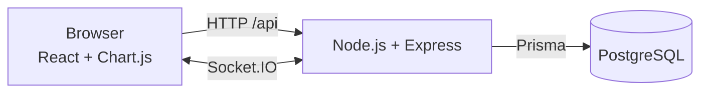
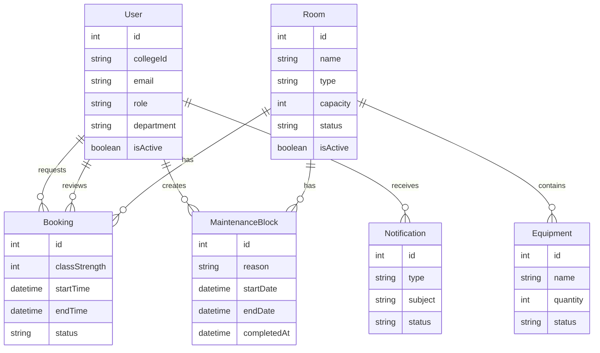
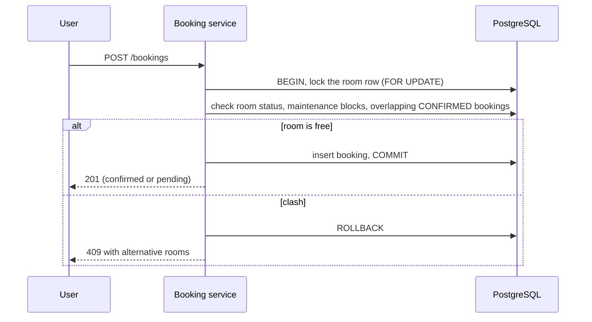
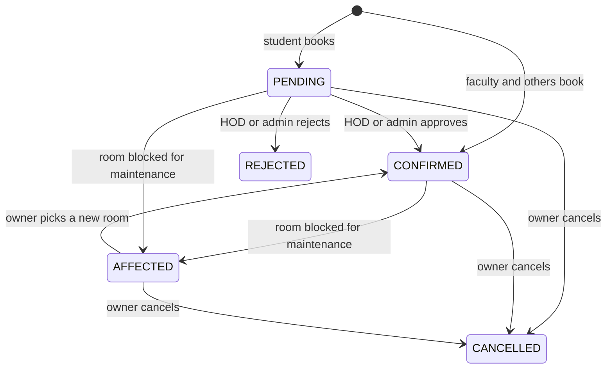

# Architecture

## Overview

Three layers, as the SRS requires (section 2.1): the React front end shows pages and forms, the Express back end enforces every rule, and PostgreSQL stores the data. The front end is never trusted to enforce rules (SRS 2.5). In development the Vite server forwards `/api` and Socket.IO traffic to the back end on port 5000.

## Code layout

| Layer | Folder | Job |
|---|---|---|
| Routes | `server/src/routes` | URL paths, who may call them (`authenticate`, `authorize`), input validation |
| Services | `server/src/services` | Business rules: booking, availability, maintenance, notifications, reports |
| Validators | `server/src/validators` | zod schemas that clean and check request data |
| Config | `server/src/config` | Prisma client, Socket.IO, optional mailer |
| Middleware | `server/src/middleware` | Login check, role check, validation, error handling |

Routes stay thin and call a service. Services hold the logic and talk to the database through Prisma.

## Data model

The full definition is `server/prisma/schema.prisma`.

## How a booking is protected from double booking

Three layers of protection (FR-021 to FR-023):

1. **Row lock.** Each booking first locks its room. Simultaneous requests for the same room queue up, so the first to arrive is checked and saved first (first come, first served).
2. **Check inside the lock.** The service looks at the room status, maintenance blocks and existing confirmed bookings. The later request now sees the earlier one and is refused.
3. **Database rule.** `prisma/sql/no_double_booking.sql` adds an exclusion constraint. PostgreSQL itself rejects two confirmed bookings for one room with overlapping times, even if the application code had a bug. Bookings that only touch (one ends exactly when the next starts) are allowed.

Only `CONFIRMED` bookings hold a slot. A student's `PENDING` request does not block the room until it is approved, and approval runs the same check again.

## Booking life cycle

## Maintenance rule

A maintenance block keeps its room unavailable from its start date until staff press "Mark room available" (FR-041). Creating a block finds the bookings that overlap the planned period, marks them `AFFECTED`, notifies the owners and lets them choose a replacement room.

## Notifications

Every booking event writes a row to the `notifications` table, and the person sees it on the app's **Notifications** page (FR-046). The events are: booking confirmed or sent for approval, approved or rejected, cancelled, changed or moved to a new room, and affected by maintenance.

Email sending is not used in this version. The code only tries to send an email if `SMTP_HOST` is set in `.env`. Left empty, each notification is saved with the status `SKIPPED`, and the server prints a short "email skipped" line in its terminal. That is normal and nothing is broken.

## Security

| Concern | How it is handled |
|---|---|
| Passwords | bcrypt with 12 rounds, never stored in plain text |
| Login | JWT, checked against the database on every request, so deactivating a user or changing a role takes effect immediately |
| Roles | `authorize(...)` on routes, with extra checks (a lab in-charge manages labs only, a HOD reviews their own department only) |
| Sign-up | Only `@nitc.ac.in` addresses, and always as a student. Admins grant other roles. |
| Input | Every request body and query is validated with zod. Unknown fields are dropped. |
| Login errors | The same message for a wrong email and a wrong password |
| Secrets | `.env` must never be committed to Git |

## Live updates

After a booking, room or maintenance change, the server emits `availability:changed` over Socket.IO. The event carries no data, so nothing private is broadcast. The search, My bookings and Approvals pages refetch when they receive it.
