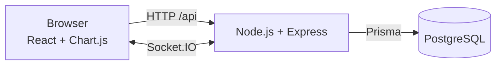
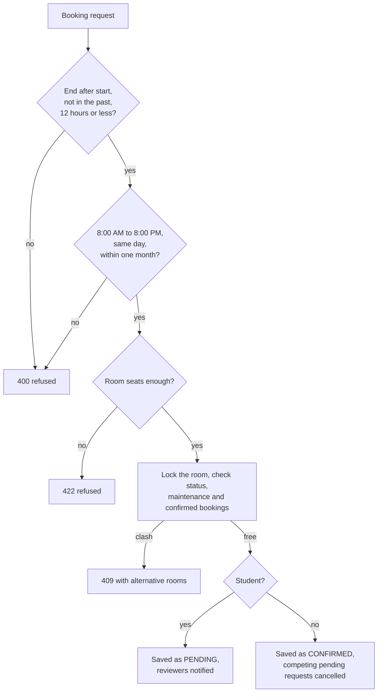
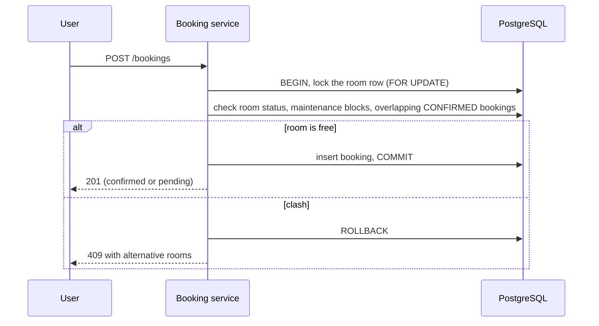
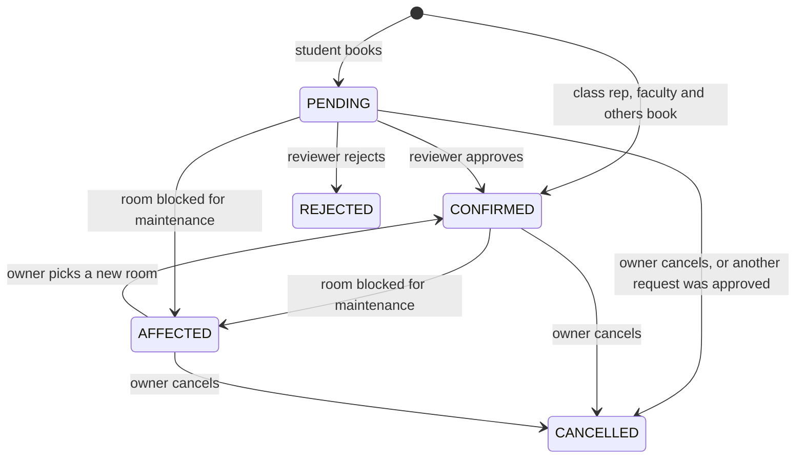
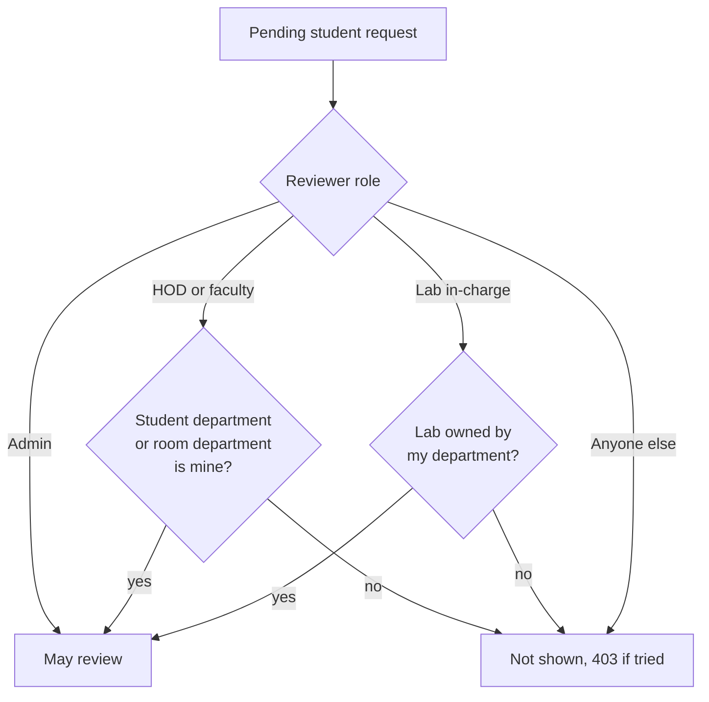

# Architecture

## Overview

Three layers, as the SRS requires (section 2.1): the React front end shows pages and forms, the Express back end enforces every rule, and PostgreSQL stores the data. The front end is never trusted to enforce rules (SRS 2.5). In development the Vite server forwards `/api` and Socket.IO traffic to the back end on port 5000.

## Code layout

| Layer | Folder | Job |
|---|---|---|
| Routes | `server/src/routes` | URL paths, who may call them (`authenticate`, `authorize`), input validation |
| Services | `server/src/services` | Business rules: booking, availability, maintenance, notifications, reports |
| Validators | `server/src/validators` | zod schemas that clean and check request data |
| Config | `server/src/config` | Prisma client, Socket.IO, optional mailer |
| Middleware | `server/src/middleware` | Login check, role check, validation, error handling |
| Utils | `server/src/utils` | Helpers, including the booking hours and window rules |

Routes stay thin and call a service. Services hold the logic and talk to the database through Prisma.

## Data model

```mermaid
erDiagram
  User ||--o{ Booking : requests
  User ||--o{ Booking : reviews
  User ||--o{ MaintenanceBlock : creates
  User ||--o{ Notification : receives
  Room ||--o{ Booking : has
  Room ||--o{ Equipment : contains
  Room ||--o{ MaintenanceBlock : has
  User {
    int id
    string collegeId
    string email
    string role
    string department
    boolean isActive
  }
  Room {
    int id
    string name
    string type
    int capacity
    string department
    string status
    boolean isActive
  }
  Booking {
    int id
    int classStrength
    datetime startTime
    datetime endTime
    string status
  }
  MaintenanceBlock {
    int id
    string reason
    datetime startDate
    datetime endDate
    datetime completedAt
  }
  Equipment {
    int id
    string name
    int quantity
    string status
  }
  Notification {
    int id
    string type
    string subject
    string status
  }
  Broadcast {
    int id
    string type
    string subject
    string message
  }
```

`Broadcast` is the campus updates feed. It has no link to a user, because it is one shared row per event. The full definition is `server/prisma/schema.prisma`.

## Booking rules

Every new booking, and every change to one, is checked on the server in this order:

The rules live in `server/src/utils/helpers.js`. The web app reads the same values from `GET /api/config`, so the date and time pickers never disagree with the server.

## How a booking is protected from double booking

Three layers of protection (FR-021 to FR-023):

1. **Row lock.** Each booking first locks its room. Simultaneous requests for the same room queue up, so the first to arrive is checked and saved first (first come, first served).
2. **Check inside the lock.** The service looks at the room status, maintenance blocks and existing confirmed bookings. The later request now sees the earlier one and is refused.
3. **Database rule.** `prisma/sql/no_double_booking.sql` adds an exclusion constraint. PostgreSQL itself rejects two confirmed bookings for one room with overlapping times, even if the application code had a bug. Bookings that only touch (one ends exactly when the next starts) are allowed.

## Pending requests and automatic cancellation

Only `CONFIRMED` bookings hold a room. Several students can have pending requests for the same room and time at once, and none of them blocks the room.

When one booking becomes confirmed, inside the same room lock, the service finds every other `PENDING` request for that room whose time overlaps, sets them to `CANCELLED` with a note, and notifies their owners. Approving a request checks availability again, so a request that lost the race cannot be approved afterwards.

## Booking life cycle

## Who reviews a request

A room with no owning department counts as owned by the student's department, and a reviewer without a department sees nothing. One setting, `REVIEW_BY` in `bookingService.js`, switches between `either` (default), `owner` (the room's department only) and `requester` (the student's department only).

Example: an ECE student asks for a CSE lab. The ECE HOD or faculty and the CSE HOD, faculty or lab in-charge can all approve it. An HOD from a third department cannot.

## Roles and who can change them

Self-registration always creates a student. Roles are then granted by:

| Who | Can switch people between |
|---|---|
| Admin | any role, for any user |
| HOD | student, class representative, faculty (own department) |
| Faculty | student, class representative (own department) |

Nobody changes their own role. A lab in-charge manages only labs owned by their own department, and admins manage all rooms.

## Maintenance rule

A maintenance block keeps its room unavailable from its start date until staff press "Mark room available" (FR-041). Creating a block finds the bookings that overlap the planned period, marks them `AFFECTED`, releases their slots, notifies the owners and lets them choose a replacement room.

## Notifications

There are two kinds, both shown on the **Notifications** page:

- **For you.** A row per person in the `notifications` table (FR-046): booking confirmed or sent for approval, approved or rejected, cancelled (including automatic cancellation), changed, affected by maintenance, and, for reviewers, a request waiting for them.
- **Campus updates.** One shared row per event in the `broadcasts` table (FR-066): a room was booked, is free again, was closed for maintenance or reopened. It shows only the room and the time, never the person or the purpose, and lists the last 30 days.

Open pages refresh by themselves through Socket.IO.

Email sending is not used in this version. The code only tries to send an email if `SMTP_HOST` is set in `.env`. Left empty, each personal notification is saved with the status `SKIPPED`, and the server prints a short "email skipped" line in its terminal. That is normal and nothing is broken.

## Reports

`reportService.js` totals confirmed bookings for a date range. Utilisation is confirmed booked hours divided by the days in the range times the 12 open hours (8 AM to 8 PM). The Reports page sorts rooms from the busiest, scales the chart axis to the data so small values stay visible, prints the value beside each bar, and switches between hours and percent.

## Security

| Concern | How it is handled |
|---|---|
| Passwords | bcrypt with 12 rounds, never stored in plain text |
| Login | JWT, checked against the database on every request, so deactivating a user or changing a role takes effect immediately |
| Roles | `authorize(...)` on routes, with extra checks (lab in-charges and reviewers are limited by department) |
| Sign-up | Only `@nitc.ac.in` addresses, always as a student, with a department. Other roles are granted by admins, HODs or faculty within their limits. |
| Input | Every request body and query is validated with zod. Unknown fields are dropped. |
| Login errors | The same message for a wrong email and a wrong password |
| Privacy | Campus updates carry no names or purposes. Socket.IO events carry no data. |
| Secrets | `.env` must never be committed to Git |
